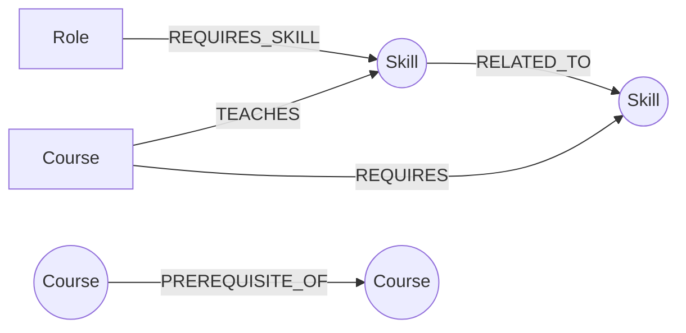

# Career Compass

**Career Compass** turns a job-search question — *"what do I actually need to learn to become an X?"* — into a graph traversal. Skills, courses and job roles are modeled as a connected graph in [CognoDB](https://console.cognodb.com), and the app walks that graph to answer questions a flat spreadsheet can't: which roles are you already closest to, which courses close the gap, and in what order should you take them given each course's own prerequisites.

Built for the Wexa AI CognoDB take-home assignment.

- **Live demo:** [wexa-career-compass.vercel.app](https://wexa-career-compass.vercel.app) (frontend on Vercel, API on Railway, data on CognoDB Cloud)
- **Screen recording:** _TODO — add link_

---

## Table of contents

1. [Why a graph database?](#why-a-graph-database)
2. [Data model](#data-model)
3. [Screenshots](#screenshots)
4. [Project structure](#project-structure)
5. [Setup](#setup)
6. [Running locally](#running-locally)
7. [The main queries, explained](#the-main-queries-explained)
8. [Error handling](#error-handling)
9. [Deployment](#deployment)

- **Recursive CTEs with no fixed depth**, because a course's prerequisite chain isn't a fixed number of joins — `python_fundamentals → python_intermediate → python_for_data_analysis → intro_machine_learning → deep_learning_specialization` is 4 hops deep in this dataset, and a different role might need a 1-hop or 6-hop chain. SQL can express *a* recursive CTE for *one* fixed relationship, but combining "walk the prerequisite chain" with "and also find the shortest conceptual bridge between two skills that aren't directly connected" means stacking multiple recursive CTEs and reconciling them in application code anyway — at which point the database has stopped doing the interesting part of the work.
- **Shortest-path queries with unbounded hop count** — "what's the closest skill I already know to this one I'm missing?" is exactly `shortestPath()` in Cypher (`SHORTEST_SKILL_BRIDGE` in [`queries.py`](backend/app/queries.py)). The relational equivalent is either a hand-rolled BFS in application code pulling the *entire* edge table into memory, or a recursive CTE with manual visited-set / cycle-guard logic re-implemented by hand.
- **Cheap traversal in any direction** — `Skill → RELATED_TO → Skill → TEACHES ← Course → PREREQUISITE_OF → Course → TEACHES → Skill ← REQUIRES_SKILL ← Role` is one pattern match in Cypher. In a relational schema each hop is another join, and the query planner has no notion that these tables represent a connected graph — every additional hop is a linear cost the database can't reason about the way a native graph index can.

None of this is *impossible* in SQL — it's that the moment "how are these things connected, and how many steps apart" becomes the actual question your product needs answered, a database built around join tables is fighting its own grain, and a graph database is answering the question directly.

## Data model

**Nodes**

